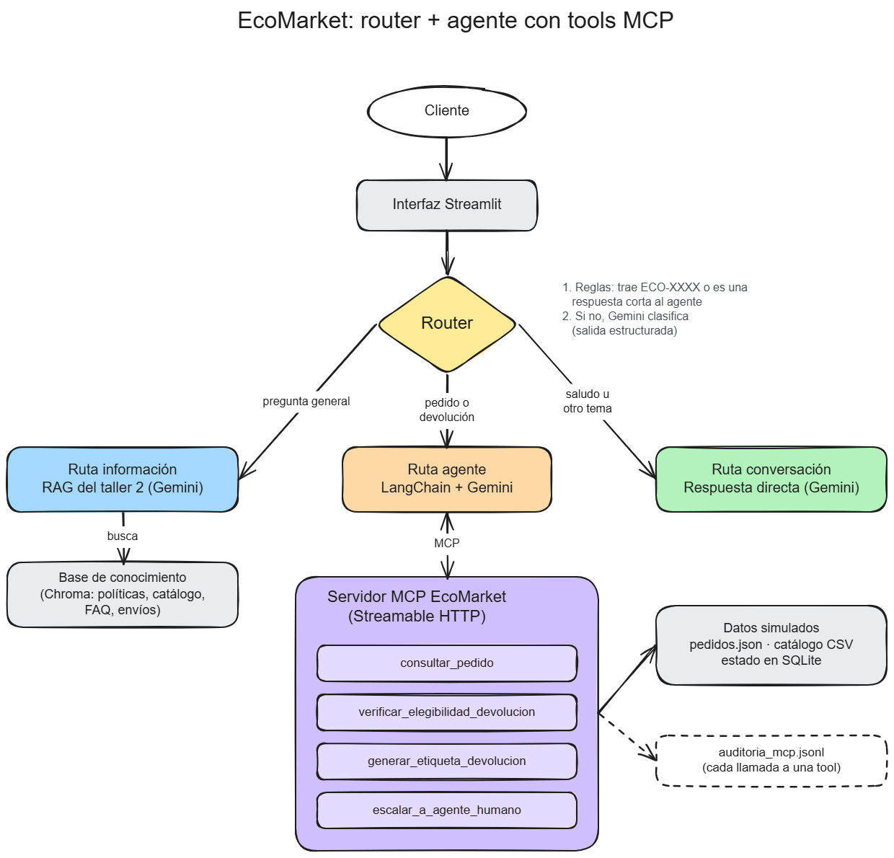
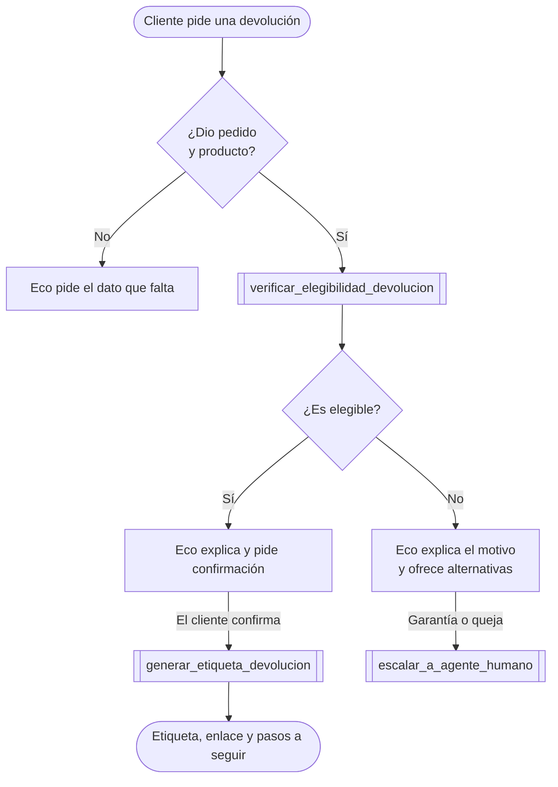

# Fase 1: Diseño de la arquitectura del agente

En el taller 2 el asistente solo informaba. Ahora el objetivo es que *actúe*: que tome la solicitud
de devolución de un cliente, verifique si cumple la política y genere la guía de envío.

## 1. Extensión de la arquitectura RAG: router con tres rutas

El enunciado permite integrar el RAG como una tool más del agente o como una ruta alterna definida
por un router. Se elige el **router**:

Cada ruta tiene un alcance distinto:

- **Información (RAG):** preguntas generales como "¿cuál es el plazo para devolver?" o "¿cuánto
  cuesta el envío?". Solo lee la base de conocimiento, no puede ejecutar acciones.
- **Agente:** cuando el cliente necesita algo sobre *su* pedido: el estado, una devolución, la
  etiqueta, un producto dañado o hablar con una persona. Es la única ruta que usa las tools.
- **Conversación:** saludos, agradecimientos, "¿qué puedes hacer?" y temas fuera de EcoMarket.
  Solo responde.

El router decide en dos pasos:

1. **Reglas:** si el mensaje trae un número de pedido (`ECO-1004`), va al agente. Si el agente
   acaba de hacer una pregunta y el cliente responde algo corto ("sí", "la botella"), también va
   al agente, para que la confirmación no se pierda en otra ruta.
2. **LLM:** si ninguna regla aplica, Gemini clasifica el mensaje con salida estructurada, así que
   solo puede responder una de las tres rutas. Si falla, el mensaje va al RAG, que es la ruta más
   segura porque no ejecuta acciones.

**Justificación**

Se evita el RAG como una tool más y se selecciona el router por:

1. **Menos riesgo de acciones indebidas:** una pregunta de política nunca llega a un componente
   capaz de generar etiquetas. Si el router se equivoca y manda algo a la ruta de información, lo
   peor que pasa es una respuesta incompleta, no una acción que nadie pidió.
2. **Menos decisiones para el LLM:** si el RAG fuera una tool, el agente tendría que elegir entre
   "buscar en documentos" y "consultar el sistema" en cada turno. Con el router, el agente solo ve
   tools transaccionales, todas relacionadas con pedidos.
3. **Reglas antes que LLM:** si el mensaje contiene un número de pedido, la ruta es obvia y se
   decide con una expresión regular, lo que ahorra tiempo y costo. El LLM interviene solo en los
   casos ambiguos.
4. **Reutilización del taller 2:** el RAG queda intacto: mismos prompts, embeddings y chunking.
   Solo cambia el paso 3 del prompt, que antes decía que no podía consultar pedidos y ahora pide
   el número del pedido para que el siguiente mensaje llegue al agente.

La desventaja es que, si un cliente mezcla en un mismo mensaje una duda de política y una
devolución, el agente no tiene el RAG para la parte de política. Se mitiga porque la tool de
verificación ya devuelve la explicación con el punto de la política que aplica.

## 2. ¿Por qué MCP para las tools?

En la clase 6 vimos que MCP resuelve el problema N×M: un servidor que expone sus capacidades con un
protocolo estándar le sirve a cualquier cliente. En EcoMarket esto se traduce en:

- **El sistema de devoluciones es un servicio aparte** (`mcp_server/`), con su propia lógica,
  datos y registro de auditoría. El agente lo consume como lo haría cualquier otro cliente MCP; el
  repositorio incluye un `.mcp.json` para conectarlo también a Claude Code.
- **El agente descubre las tools al arrancar:** `MultiServerMCPClient` lee el nombre, la
  descripción y el esquema que publica el servidor y los convierte en tools de LangChain. Si el
  servidor agrega una tool nueva (por ejemplo `crear_orden_reemplazo`), el agente la ve sin tocar
  su código.
- **La política la aplica el código, no el LLM:** la elegibilidad la decide
  `mcp_server/devoluciones.py`, que es determinista y tiene pruebas unitarias. El LLM conversa,
  pide datos y explica, pero no decide si un champú se puede devolver.

**Transporte:** se usa Streamable HTTP (`http://127.0.0.1:8001/mcp`) y no `stdio`, siguiendo la
recomendación de la clase de preferir servidores remotos: el servidor corre como un proceso
independiente y puede atender varios clientes.

## 3. Definición de tools

Se aplican buenas prácticas de diseño de servidores MCP:

- Pocas tools, agrupadas por intención.
- Errores como resultados legibles: cada error trae `codigo`, `mensaje` y `sugerencia`.
- Anotaciones MCP (`readOnlyHint`, `idempotentHint`, `destructiveHint`).
- Registro de cada invocación (tool, argumentos, resultado y duración) en `logs/auditoria_mcp.jsonl`.
- Confirmación del cliente antes de la acción con efectos.

Son 4 tools, simuladas sobre los 12 pedidos del taller 1 (`data/pedidos.json`) y el catálogo del
taller 2 (`documentos/catalogo-productos.csv`). El catálogo es el mismo archivo que indexa el RAG,
así hay una sola fuente de verdad sobre qué productos son devolvibles.

### 3.1 `consultar_pedido` (readOnlyHint)

| | |
|---|---|
| **Propósito** | Saber el estado de un pedido o qué productos tiene. Cubre el ejercicio de pedidos del taller 1, que el RAG del taller 2 no podía resolver. |
| **Entrada** | `numero_pedido: str`. Acepta `ECO-1004`, `eco 1004` o `ECO1004`. |
| **Salida** | `{"ok": true, "numero", "cliente", "ciudad", "productos": [...], "estado", "fecha_compra", "entrega_estimada", "fecha_entrega"?, "rastreo", "motivo_retraso"?}` |
| **Errores** | `FORMATO_INVALIDO`, `PEDIDO_NO_ENCONTRADO` |

### 3.2 `verificar_elegibilidad_devolucion` (idempotentHint)

| | |
|---|---|
| **Propósito** | Aplicar la política de devoluciones a un producto de un pedido. El agente debe llamarla antes de decir si algo se puede devolver. |
| **Entrada** | `numero_pedido: str`, `producto: str` (como lo dice el cliente, por ejemplo "la botella"), `motivo: enum` (`no_satisfecho`, `cambio_de_opinion`, `talla_o_modelo`, `danado`, `defectuoso`, `vencido`, `otro`). |
| **Salida** | `{"ok": true, "verificacion_id": "VER-…", "pedido", "cliente", "producto", "categoria", "motivo", "dias_desde_entrega", "elegible": bool, "codigo_decision", "explicacion", "alternativas": [...], "requiere_foto"?}` |
| **Errores** | `MOTIVO_INVALIDO`, `FORMATO_INVALIDO`, `PEDIDO_NO_ENCONTRADO`, `PRODUCTO_NO_EN_PEDIDO` (incluye la lista de productos del pedido), `PRODUCTO_AMBIGUO` |

Reglas que aplica, en orden (cada una corresponde a un punto de la política de devoluciones):

| `codigo_decision` | Condición | ¿Elegible? |
|---|---|---|
| `NO_ENTREGADO` | El pedido no está "Entregado" (punto 6) | NO |
| `EXCEPCION_DANO` | Motivo dañado, defectuoso o vencido y ≤ 5 días desde la entrega (punto 4), aunque la categoría no sea devolvible | SI (pide foto) |
| `CATEGORIA_NO_DEVOLVIBLE` | Alimentos, higiene personal, higiene íntima o digital (punto 3) | NO |
| `DENTRO_DE_PLAZO` | Devolvible y ≤ 30 días desde la entrega (punto 1) | SI |
| `APLICA_GARANTIA` | > 30 días, motivo de daño y garantía vigente | NO, se escala a un humano |
| `FUERA_DE_PLAZO` | > 30 días | NO |

El `verificacion_id` siempre es el mismo para el mismo pedido, producto, motivo y fecha. Por eso,
en el turno en que el cliente confirma, el agente puede volver a verificar sin crear duplicados,
aunque el historial del chat solo guarde texto.

### 3.3 `generar_etiqueta_devolucion` (idempotentHint)

| | |
|---|---|
| **Propósito** | Generar la guía prepagada, solo después de que el cliente confirma. |
| **Entrada** | `verificacion_id: str` |
| **Salida** | `{"ok": true, "numero_etiqueta": "ETQ-20260915-0001", "pedido", "producto", "transportadora", "url_etiqueta", "enviar_antes_de", "reembolso", "instrucciones": [...], "ya_existia": bool}` |
| **Errores** | `VERIFICACION_NO_ENCONTRADA`, `NO_ELEGIBLE` |

La tool solo recibe el `verificacion_id`, no los datos del pedido. Así el LLM no puede armar una
etiqueta con datos inventados, y aunque lo intente, el servidor no genera etiquetas para
devoluciones no elegibles. Si ya existe una etiqueta para ese pedido y producto, devuelve la misma
con `ya_existia: true`, de modo que un reintento nunca crea dos guías.

### 3.4 `escalar_a_agente_humano`

| | |
|---|---|
| **Propósito** | Garantías, quejas, casos fuera de la política, errores del sistema o cuando el cliente pide hablar con una persona (punto 7 de la política). |
| **Entrada** | `motivo: enum` (`garantia`, `queja`, `caso_especial`, `error_del_sistema`, `solicitud_del_cliente`), `resumen: str`, `numero_pedido: str` opcional |
| **Salida** | `{"ok": true, "numero_caso": "CASO-…", "tiempo_respuesta"}` |

> El enunciado pide mínimo dos tools además del RAG. Las principales son
> `verificar_elegibilidad_devolucion` y `generar_etiqueta_devolucion`; `consultar_pedido` cubre el
> estado de los pedidos y `escalar_a_agente_humano` le da al agente una salida cuando no puede
> resolver el caso.

## 4. Selección del framework: LangChain

Se compararon LangChain y LlamaIndex en los puntos que más pesan para este proyecto:

- **Continuidad con el taller 2:** el RAG ya está hecho en LangChain (Chroma, loaders, splitter y
  prompt), así que el agente reutiliza el mismo modelo y los mismos objetos. Con LlamaIndex habría
  que migrar el RAG o mezclar dos frameworks.
- **Integración con MCP:** LangChain tiene `langchain-mcp-adapters`, que convierte las tools de un
  servidor MCP en tools de LangChain en una línea. LlamaIndex también tiene su adaptador
  (`llama-index-tools-mcp`), así que en este punto es indiferente.
- **Facilidad para crear el agente:** en LangChain 1.x basta con
  `create_agent(modelo, tools, system_prompt)`, y por estar construido sobre LangGraph trae límite
  de pasos y la opción de agregar memoria después. Los agentes de LlamaIndex (`FunctionAgent`,
  `ReActAgent`) son igual de simples.
- **Soporte para Gemini:** ambos lo tienen (`langchain-google-genai` y
  `llama-index-llms-google-genai`).
- **Fortaleza de cada uno:** LangChain es más fuerte orquestando agentes y tools, mientras que
  LlamaIndex lo es en ingesta e indexación de datos.

Se elige **LangChain** porque el reto nuevo es orquestar el router, el agente y las tools, no
indexar datos, y porque mantener un solo framework deja menos dependencias.

**Modelo:** se conserva **Gemini** (`gemini-3.6-flash`, configurable en `.env`) para el router, el
RAG, el agente y la ruta de conversación, y `gemini-embedding-001` para los embeddings.

## 5. Flujo de trabajo del proceso de devolución

**Nota:**
Las decisiones de conversación (qué preguntar, cuándo pedir confirmación) las toma el agente; las
que dependen de la política (si es elegible, si se puede generar la etiqueta) las toma el servidor
MCP con reglas fijas.
